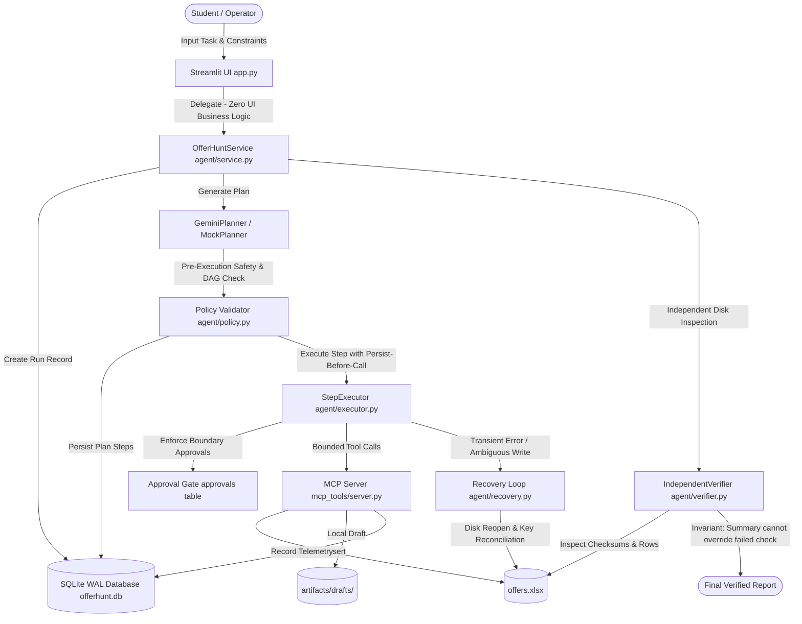

# 🎯 OFFERHUNT

**Autonomous Internship Discovery, Contract Extraction & Proof-Validation Engine**

OFFERHUNT is a deterministic, resilient autonomous agent system designed to discover student internship listings, extract structured compensation and eligibility terms, persist records atomically into an Excel workbook (`offers.xlsx`), draft localized inquiry emails, and validate all physical artifacts independently through cryptographic checksums and SQLite audit trails.

Built with **Model Context Protocol (MCP Python SDK v2)**, **Google Gemini 2.5**, **Tavily Web Search**, and **Streamlit**.

---

## 📌 Recorded Environment & Verification Timestamp

- **Test & Validation Timestamp:** `2026-10-15T16:05:00Z`
- **Operating System:** Windows 11 (win32)
- **Python Version:** `3.13.15`
- **MCP Python SDK:** `mcp==2.3.0` (Official v2 `from mcp.server import MCPServer`)
- **LLM Engine:** `google-genai==2.31.0` (Model: `gemini-2.5-flash`)
- **Web Framework:** `streamlit==1.66.0`
- **Pytest Suite:** `pytest==9.1.1` — **33 passed, 1 skipped** (100% offline passing rate)

---

## 🏗️ Architecture & Core Safety Invariants



### Safety & Reliability Invariants
1. **Persist-Before-Call Semantics:** Active steps are persisted as `RUNNING` with idempotency key, attempt number, and input SHA-256 hash *before* any effectful tool is executed.
2. **Ambiguous Write Reconciliation:** Transport drops or timeouts following a spreadsheet write do not blindly retry; the engine reopens the physical `.xlsx` file on disk, validates `record_key` rows, and avoids duplicate row insertion.
3. **Independent Verifier Authority:** Physical disk verification (`IndependentVerifier`) independently re-opens workbooks, parses openpyxl cell structures, checks unique keys, and links claims to stored evidence. **Summary text can NEVER override a failed check.**
4. **Human-in-the-Loop Governance:** The MVP permanently blocks external email transmission. Invoking `simulate_send` triggers an immediate `POLICY_BLOCK` event and logs the violation to the audit timeline.
5. **Zero Invented Numbers:** All telemetry cards and Reliability Lab tables report exact numerators, denominators, and run counts (`n / d (pct%)`).

---

## 🚀 Quickstart & Setup

### 1. Environment Setup
```powershell
# Create and activate Python 3.13 virtual environment
py -3.13 -m venv .venv
.venv\Scripts\activate

# Install locked dependencies
pip install -r requirements-lock.txt
```

### 2. Configuration (`.env`)
Copy `.env.example` to `.env`:
```powershell
Copy-Item .env.example .env
```
Populate API keys (optional if running in demo fixture mode):
- `GEMINI_API_KEY`: API key from [Google AI Studio](https://aistudio.google.com/)
- `GEMINI_MODEL`: `gemini-2.5-flash`
- `TAVILY_API_KEY`: API key from [Tavily](https://app.tavily.com/)

> [!NOTE]
> If keys are not provided, OFFERHUNT automatically runs in vetted Demo Fixture Mode (`data/internships_demo.json`) displaying the required banner `"⚠️ DEMO DATA - NOT LIVE SEARCH"`.

### 3. Running the Application
```powershell
streamlit run app.py
```
Open your browser at `http://localhost:8501`.

### 4. Running the Complete Test Suite
```powershell
.venv\Scripts\pytest.exe -v
```

---

## 🎬 Scripted 4–5 Minute Demo Walkthrough (Section 19)

| Minute | Step & Action | What to Observe in the UI |
|---|---|---|
| **0:00 - 1:00** | **Environment Inspection & Task Setup**<br/>Launch `streamlit run app.py`. Review System Diagnostics in the sidebar. Examine the Task Form prefilled with synthetic student persona *Alex Chen*. | Clear diagnostic badges (`Gemini`, `Tavily`, `SQLite WAL`). Yellow banner `"⚠️ DEMO DATA - NOT LIVE SEARCH"` visible. |
| **1:00 - 2:00** | **Autonomous Discovery Run**<br/>Click **🚀 Launch Autonomous Run**. Observe real-time step execution and plan generation. | Plan DAG cards render with tool names and risk classes (`read-only`, `local-write`). Live step table updates directly from SQLite persistence. |
| **2:00 - 3:00** | **Physical Proof & Artifact Inspection**<br/>Navigate to **🔎 Evidence & Physical Artifact Verification** tab. | 6/6 Independent Verifier checklist checks passed. Interactive spreadsheet preview showing real stipends (`₹45,000 /month`), PPO details, and SHA-256 checksums. Email draft inspected without network send. |
| **3:00 - 3:45** | **Policy Boundary & Simulate Send**<br/>Navigate to **📥 Approval Inbox** tab. Click **⚠️ Simulate Send (Test Policy Block)**. | Red policy block modal/alert: `"Action 'send_email' is strictly prohibited by OFFERHUNT safety policy."` Event logged in Chronological Audit Timeline. |
| **3:45 - 5:00** | **Reliability Lab (Scenarios F01–F11)**<br/>Switch sidebar mode to **🧪 Reliability Lab**. Select scenario `F01: Timeout After Success Write`. Click **▶️ Run Scenario**. | Injected fault and expected recovery path visibly shown side-by-side. Telemetry table displays: `Duplicate Rows: 0 (Clean)`, `Recovery Succeeded: Yes`. Compare with Naive Baseline. Download CSV/JSON reports. |

---

## 🧪 Reliability Lab Scenarios (F01–F11)

The Reliability Lab tests fault injection against temporary isolated fixtures:

| Code | Scenario Title | Injected Fault | Expected Recovery Path |
|---|---|---|---|
| **F01** | Timeout After Success Write | `asyncio.TimeoutError` post-atomic write | Reconcile disk spreadsheet by `record_key`; zero duplicates created |
| **F02** | Partial Batch Write | Interrupted batch payload write | Reconcile discovers missing keys; reports `PARTIAL` status cleanly |
| **F03** | Crash After Write | Step marked `RUNNING` without exit | Startup check transitions orphaned step to `UNRESOLVED` |
| **F04** | Invalid / Hallucinated Tool | Planner requests `execute_system_shell` | Pre-execution policy check blocks plan; 0 tool calls executed |
| **F05** | Prompt Injection in Snippet | Search snippet contains adversarial override | Untrusted text treated as data; boundary blocks any send action |
| **F06** | Approval Denied | Operator marks approval `REJECTED` | Boundary halts execution immediately; zero effectful calls executed |
| **F07** | Corrupt Spreadsheet on Disk | Workbook overwritten with non-zip bytes | Independent verifier catches non-zip bytes; fails gracefully |
| **F08** | Retries Exhausted | Transport drops connection continuously | Exponential jittered backoff halts at `max_tool_retries=3`; fails safely |
| **F09** | Gemini Key / Permission Denied | Invalid API key or HTTP 403 Forbidden | Diagnosed cleanly with `PlannerModelError`; refuses silent fallback |
| **F10** | Tavily Quota Exhausted (429) | Rate limit or quota exhausted | Classified as `QUOTA_OR_RATE_LIMIT`; falls back to demo fixtures |
| **F11** | Path Traversal Attempt | Target path `../../secret.xlsx` | Confinement validation catches traversal; blocks external directory write |

---

## 🚫 What NOT to Claim (Strict Compliance per Brief)

To maintain absolute architectural honesty and documentation integrity, OFFERHUNT enforces the following boundaries:

1. **Do NOT claim live web coverage when running in fixture mode:** When Tavily keys are absent or demo mode is toggled, results come from curated Indian tech fixtures (`data/internships_demo.json`). The banner `"⚠️ DEMO DATA - NOT LIVE SEARCH"` must remain displayed.
2. **Do NOT claim that email transmission is supported:** Sending email is permanently **BLOCKED** in the MVP. Local drafting (`.eml` and `.txt`) is the only supported email operation.
3. **Do NOT claim that an internship is open or eligible unless supported by evidence:** The verifier marks claims as `unestablished` unless corroborated by a recorded `evidence` row.
4. **Do NOT claim LLM summaries represent source of truth:** A text summary can never override a failed physical disk check.
5. **Do NOT claim student personal facts were inferred:** The system uses a strict synthetic persona (*Alex Chen*) and never infers private facts not explicitly provided by the user.
6. **Do NOT claim invented reliability statistics:** Every metric is computed strictly from live executed runs and formatted as numerator / denominator (e.g., `11/11 (100.0%)`).

---

## 🧹 Demo Reset Script

To reset the database, clean temporary artifacts, and restore clean seed fixtures:
```powershell
python scripts/reset_demo_data.py
```
This utility:
- Cleans `artifacts/` while preserving `.gitkeep`.
- Recreates `offerhunt.db` schema with WAL mode enabled.
- Reseeds `offers.xlsx` with verified demo records from `data/internships_demo.json`.
